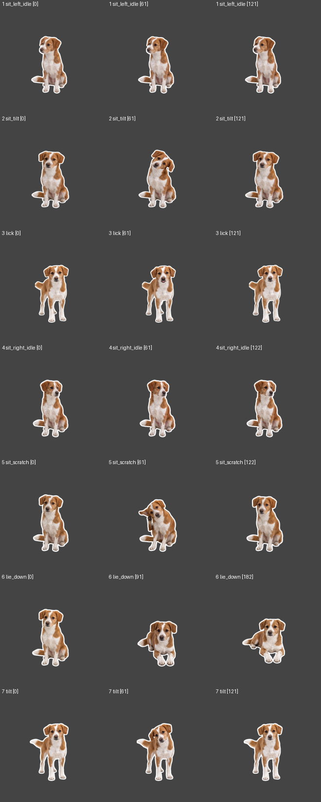

# 桌宠

从几张宠物照片出发，让 Agent 按一套明确的方法规划并推进桌宠制作。

这里整理了 **照片 → 标准姿态图 → 动作表 → 配对的图像／视频提示词 → 首尾帧交接 → 透明素材 → 互动程序 → 发布** 的流程，并开放已完成的 **诞诞桌宠 0.3.2** 作为源码和运行示例。



## 我想给自己的宠物做桌宠

1. 下载 [windows-desktop-pet-skill.zip](https://github.com/woshibiantai06/desktop-pet/releases/tag/workflow-v1.0.0)，或将本仓库的 [Skill 文件夹](skills/windows-desktop-pet) 交给能读取文件的 Agent。
2. 上传几张宠物照片，尽量包含清楚的脸部和全身；缺少的视角先标为未知。
3. 把下面这句话发给 Agent：

> 先读取这个 Skill。根据我的宠物照片，按里面的流程带我制作桌宠：给出完整动作表、每段的静态图和动态视频提示词、输入参考图、首尾帧如何衔接、生成顺序和验收方法；我会把生成的素材陆续交回来，请从第一步开始。

4. 按卡片先制作并确认标准图，再分批生成动作，把视频和实际取出的参考帧交回 Agent。
5. 素材通过后，继续做透明处理、程序接入、互动和打包。需要执行代码的阶段，应使用具备本地开发环境的 Agent。

如果你的 Agent 只方便读一个文本文件，可用同一 Release 中的 **pet-workflow.md**；其中展开了完整流程与参考内容。附件读取、图像／视频生成、执行代码的能力取决于你使用的工具。没有视频生成工具时，Agent 先给提示词，你在自己的平台生成后交回素材即可。

## 它应该给出什么

- 宠物身份特征与未知视角，不把照片未拍到的花纹当成事实。
- 明确的动作需求表：站坐趴、往返、日常小动作、左右走路、摸头、键盘和出入场；按需求裁剪。
- 每个动作配对的静态参考图提示词与动态视频提示词。
- 哪张图作为首帧，尾帧是已有目标图、上一段实取帧，还是生成后再验收。
- 哪些标准图要新生成，哪些应该直接复用合格尾帧。
- 逐步生成顺序、验收条件、失败回退，以及拿到视频后如何继续。

例如坐下的尾帧通过后可以建立坐姿基准，供坐姿待机和趴下使用；站姿舔鼻、歪头等则复用同一张站姿基准，不把所有视频盲目串成一条尾帧链。

## 看一个完整例子

- [诞诞源码与运行说明](examples/dandan/README.md)
- [Windows 11 x64 免安装完整包](https://github.com/woshibiantai06/desktop-pet/releases/tag/dandan-v0.3.2)
- [从照片开始的独立规划示例](docs/planning-example/README.md)
- [真实做过的流程与本次补充的规范](skills/windows-desktop-pet/references/verified-dandan-workflow.md)

诞诞支持自然待机、站坐趴、三姿态摸头、左右拖动走路、键盘联动、自由活动开关和动画退出。完整例子有 40 个来源动作、57 个运行片段；大型帧资源和完整成品通过 Release 提供，源码仓库不存放数 GB 数组。

## 当前验证范围

诞诞 0.3.2 的完整包曾完成实际解压、338 个载荷文件逐个核验和本机正常首开；来源动作覆盖与功能诊断、正常速度采样分开记录。这个历史示例不证明另一只宠物生成的所有动作都合格。

本版 Skill 的验证包括元数据与引用检查、动作路线工具检查，以及由另一位未参与编写的 Agent 从照片完成规划试走。试走范围与结果见规划示例说明。尚不承诺不同视频模型、不同电脑上无人干预地产出完全相同成品；生成素材仍需要按卡片验收。

## 仓库结构

```text
skills/windows-desktop-pet/   给 Agent 的制作流程、动作库和提示词规范
examples/dandan/             诞诞实际 Python/PySide6 源码、配置、预览与资源准备工具
docs/planning-example/       独立 Agent 从照片试走的规划结果
scripts/                    技能打包与仓库检查工具
tests/                      可在普通 Python 环境运行的检查
```

## 开发与校验

```text
python -m unittest discover -s tests -v
python scripts/check_repo.py
python scripts/package_skill.py --output dist
```

运行诞诞源码另需安装其依赖和下载运行素材，详见示例说明。仅生成制作计划不需要安装 Python。

## 许可

本仓库原创代码与文档使用 [MIT License](LICENSE)。Release 中随程序分发的 Python、Qt/PySide6 等第三方组件保留各自许可，相关说明随完整包一同提供。示例动画是制作过程中的生成素材，不能代替新宠物照片的身份参考。
