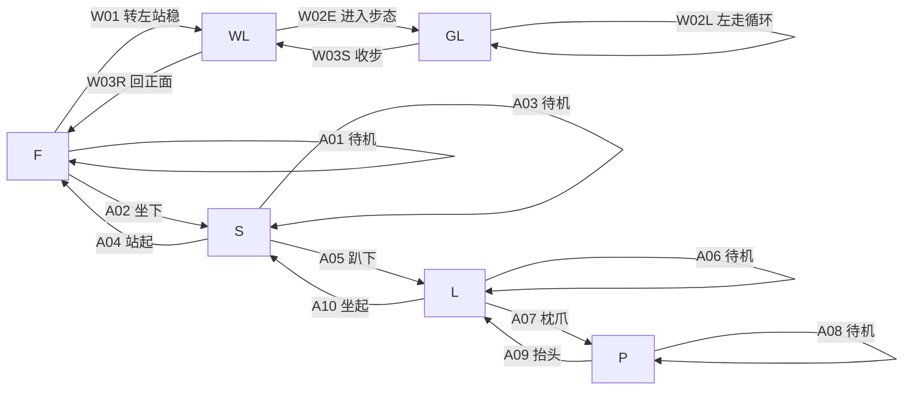

# 动作图、总表与完整提示词

[角色与标准图](01-角色与标准图.md) · [实际生成顺序](03-生成顺序与交接.md) · [素材与程序交接](04-素材验收与程序交接.md)

本文件一次给全本轮 15 条视频卡。全部状态均为“待生成”；输入 E 帧必须等上游视频真实通过才会存在。每条先生成一个候选，边做边验收，不一次投完。

## 状态与闭环

F 正面站稳；S 正面坐稳；L 抬头趴稳；P 枕爪趴稳；WL 鼻子朝画面左侧的侧身站稳；GL 左侧原地走路的约定接地点相位。WL 和 GL 不合并：站稳帧与正在走路的相位不能硬切。



正常关闭通过程序入口结束本轮，未制作离场动画。站坐趴枕爪都有返回 F 的路线；GL 的退出必须先收步再回正面。

| ID | 目的／阶段 | 起止 | 实际首图 | 目标尾图／尾帧用途 | 文件 |
| --- | --- | --- | --- | --- | --- |
| A01 | 第一批，站立待机 | F→F | I-F | 回 I-F 附近；不改基准 | V-A01_v1.mp4 |
| A02 | 第一批，坐下 | F→S | I-F | 最后稳定合格帧建立 E-S | V-A02_v1.mp4 |
| A03 | 第一批，坐姿待机 | S→S | E-S | 回 E-S；不改基准 | V-A03_v1.mp4 |
| A04 | 第一批，坐姿站起 | S→F | E-S | 原 I-F | V-A04_v1.mp4 |
| A05 | 第二批，趴下 | S→L | E-S | 建立 E-L | V-A05_v1.mp4 |
| A06 | 第二批，抬头趴待机 | L→L | E-L | 回 E-L；不改基准 | V-A06_v1.mp4 |
| A07 | 第三批，枕爪 | L→P | E-L | 建立 E-P | V-A07_v1.mp4 |
| A08 | 第三批，枕爪待机 | P→P | E-P | 回 E-P；不改基准 | V-A08_v1.mp4 |
| A09 | 第三批，枕爪抬头 | P→L | E-P | 原 E-L | V-A09_v1.mp4 |
| A10 | 第二批，趴姿坐起 | L→S | E-L | 原 E-S | V-A10_v1.mp4 |
| W01 | 第四批，左转进入 | F→WL | I-F | 建立 E-WL | V-W01_v1.mp4 |
| W02E | 第四批，进入步态 | WL→GL | E-WL | 实际可重复步态相位 E-GL | V-W02E_v1.mp4 |
| W02L | 第四批，持续左拖 | GL→GL | E-GL | 同一 E-GL 相位 | V-W02L_v1.mp4 |
| W03S | 第四批，收步 | GL→WL | E-GL | 原 E-WL | V-W03S_v1.mp4 |
| W03R | 第四批，返回正面 | WL→F | E-WL | 原 I-F | V-W03R_v1.mp4 |

## 上传方法：所有卡片适用

仅支持首帧：只上传卡片指定的“首图”作为首帧；目标尾图保留在旁边对照，使用本卡动态正文。平台如另有角色参考槽且实际支持，再将 P01 放该槽。不能拿 P01 近照替换全身首图，也不能把目标尾图伪装成第二张首帧。

支持首尾帧：首槽放卡片的实际首图，尾槽放已经存在且通过的目标图。A01/A03/A06/A08 待机和 W02L 循环可用相同基准图作首尾。A02/A05/A07/W01 初次建立姿态时没有真实尾图，默认只用首图；需要尾图时才生成对应备用目标静态图。W02E 默认仅首帧，从实际进入步态的视频建立 E-GL，不编造未来尾图。

所有可复制正文已包含外貌、起止、机位、背景。保存为卡片的计划文件名；平台若输出其他容器，保留真实扩展名并在清单登记，不改后缀冒充格式。每条还保存一张实际尾部检查帧到 `QA-ID-end_v1.png`，在交接表填写实际时间戳和帧号；它只用于检查，除卡片明确授权外不升级基准。

## A01 站姿待机

- 用途／阶段／状态：第一批；自然陪伴；F→F。
- 依赖与输入：I-F 已认可；I-F 作首图及可选尾图，P01 只作身份补充。
- 静态处理：复用 I-F；不新生成。备用静态提示词见[完整 I-F 卡](01-角色与标准图.md#i-f现在实际执行的第一步)。
- 建议目标：4–6 秒，包含温和呼吸与一轮幅度很小的尾部摆动，不强迫不完整尾巴做大动作。

```text
以提供的全身正面站姿 I-F 为首帧，保持同一只写实棕白小狗：暖棕头毛与肩颈、自然下垂双耳、额头到鼻梁白纹、白色口鼻下巴、宽白胸和白色前肢、暗棕眼睛、棕褐鼻头与深色鼻孔，体型、花纹和尾巴与 I-F 一致。小狗始终正面四脚站稳，做轻微胸腹呼吸和幅度很小的自然尾部摆动，动作一轮后回到可接 I-F 的相同姿态，四脚不挪位置；头不持续左右转动。固定机位焦距和站立胸部附近的镜头高度，正方形画布目标 1024×1024，主体居中，脚底参考高度约 87.5%，耳尾全身完整且四周至少约 8% 余量。均匀中性灰背景目标 #808080，柔和固定正面偏上光照，无地面纹理、明显投影、文字、水印和额外物体。真实毛发，自然速度，首尾呼吸相位和尾巴运动方向可连续衔接；不缩放、不滑步、不变脸、不增加肢体、不用倒放循环。
```

- 循环／尾帧：实际找相位相近、速度连续的循环切点；V-A01 不建立新 F。端点检查帧保存 QA-A01-end_v1.png。
- 验收／失败：检查四脚稳定、尾巴完整、首尾速度；尾部循环跳动就减小摆幅并重做当前片段，不能让其他动作跟随其坏尾帧。
- 下一步：生成 A02，并先回传 A01/A02 检查身份与坐姿。

## A02 正面坐下

- 用途／阶段／状态：第一批，建立坐姿；F→S。
- 依赖与输入：I-F 已认可；首图 I-F。无现成 E-S；仅需要目标尾图时使用[坐姿备用卡](01-角色与标准图.md#i-s-target坐姿备用)生成 I-S-target，经认可后作尾图。
- 静态处理：复用 I-F；坐姿静态备用默认不执行。
- 建议目标：3–5 秒；起止各约 0.3–0.5 秒停稳。

```text
从提供的全身正面站姿 I-F 开始，让同一只写实棕白小狗自然坐下。保留暖棕头毛与肩颈、下垂双耳、额头至鼻梁白纹、白色口鼻下巴、宽白胸和白色前肢、暗棕眼睛、棕褐鼻头与深色鼻孔，体型花纹尾巴不变。先四脚站稳，再轻微转移重心，后腿逐渐屈曲，臀部平稳落向地面，前爪只做必要的小幅承重调整，最终正面坐稳，前肢伸直支撑、头自然抬起并短暂停稳；如提供坐姿尾图，最终自然到达该图，不靠溶解变形。固定机位焦距与站立胸部附近镜头高度，正方形画布目标 1024×1024，主体居中，地面接地点约在高度 87.5%，坐姿自然变低而不放大，耳尾四肢完整且四周至少约 8% 余量。均匀中性灰背景目标 #808080，柔和固定正面偏上光照，无地面纹理、明显投影、文字、水印和额外物体。自然犬类承重，不瞬移、不滑步、不增减腿、不改脸、不镜头移动。
```

- 尾帧／循环：一次正向转换，不循环。通过后选最后稳定、睁眼、四肢正确的帧保存 E-S_v1.png；登记来源 V-A02 和真实时间戳／帧号。QA-A02-end_v1.png 可与该帧相同。
- 验收／失败：坐下过程要有屈腿与落臀；坏坐姿不建立 E-S。脸和比例错误回 I-F；只有动作问题重做 A02，A03/A04/A05 全部等待。
- 下一步：A02 通过并建立 E-S 后生成 A03、A04。

## A03 坐姿待机

- 用途／阶段／状态：第一批，自然陪伴；S→S。
- 依赖与输入：E-S 真实通过；首图及可选尾图均为 E-S。
- 静态处理：复用 E-S；不新生成。[坐姿完整静态备用卡](01-角色与标准图.md#i-s-target坐姿备用)只供返工时使用。
- 建议目标：4–6 秒。

```text
以提供的正面坐姿基准 E-S 为首帧，让同一只写实棕白小狗保持坐姿轻微呼吸。保持暖棕头毛与肩颈、下垂双耳、额头鼻梁白纹、白色口鼻下巴、宽白胸与白色前肢、暗棕眼睛、棕褐鼻头和深色鼻孔，体型、花纹、尾巴与 E-S 相同。臀部和两只前爪原地稳定，胸腹微动，耳尖可以轻微自然颤动，头保持正面，不起身、不趴下；结束恢复到能接原 E-S 的坐姿与呼吸相位。固定机位焦距与站立胸部附近镜头高度，正方形画布目标 1024×1024，主体居中，接地点约在高度 87.5%，坐姿保持原高度不被放大，耳尾完整且四周至少约 8% 余量。均匀中性灰背景目标 #808080，柔和固定正面偏上光照，无地面纹理、明显投影、文字、水印和额外物体。真实毛发、自然速度，首尾速度连续，不改变轮廓比例、不滑爪、不变脸、不多出肢体、不倒放。
```

- 尾帧／循环：V-A03 的检查帧 QA-A03-end_v1.png 不替换 E-S；实际选一轮正向可接的微动。
- 验收／失败：臀部、前爪和脸不漂移；循环呼吸跳动则重做 A03，不改 A02 基准。
- 下一步：生成 A04 检查能否回到原 I-F。

## A04 坐姿站起

- 用途／阶段／状态：第一批，自然返回；S→F。
- 依赖与输入：首图 E-S；尾图目标是原 I-F。仅首帧时旁看 I-F 核对尾姿态，支持首尾图时上传两者。
- 静态处理：复用 E-S 与 I-F；不新生成。[I-F 完整卡](01-角色与标准图.md#i-f现在实际执行的第一步)是返回目标，不另造一个 F。
- 建议目标：3–5 秒，结束站稳约 0.5 秒。

```text
从提供的正面坐姿 E-S 开始，让同一只写实棕白小狗自然站起并回到原 I-F 正面站姿。保留暖棕头毛与肩颈、自然垂耳、额头到鼻梁白纹、白色口鼻下巴、宽白胸及白色前肢、暗棕眼睛、棕褐鼻头和深色鼻孔，体型、花纹、尾巴保持同一角色。前爪稳定支撑，身体轻微前倾，后腿逐渐伸展把臀部抬起，再协调前后肢承重，四脚正面站稳，回到 I-F 的身体位置和自然高度，短暂停稳。固定机位焦距与站立胸部附近镜头高度，正方形画布目标 1024×1024，主体居中，脚底接地点约在高度 87.5%，耳尾全身完整且四周至少约 8% 余量。均匀中性灰背景目标 #808080，柔和固定正面偏上光照，无地面纹理、明显投影、文字、水印和额外物体。自然正向起身，不倒放坐下，不滑步、不整身上浮、不溶解成目标图、不变脸、不多腿、不镜头移动。
```

- 尾帧／循环：一次转换；QA-A04-end_v1.png 对照 I-F，不能替换 I-F。
- 验收／失败：前后躯有真实承重，脚底、身体大小、尾部与 I-F 接得上；动作好但尾不合时重做收尾或补桥接，不硬切。第一批未闭环前不解锁第二批。
- 下一步：回传第一批站坐完整往返；通过后做 A05。

## A05 坐姿趴下

- 用途／阶段／状态：第二批，建立趴姿；S→L。
- 依赖与输入：第一批闭环通过；首图 E-S。尾图暂不存在；需预览时才用[抬头趴备用卡](01-角色与标准图.md#i-l-target抬头趴姿备用)。
- 静态处理：复用 E-S；不重复生成姿态。
- 建议目标：4–6 秒；结束抬头趴稳约 0.5 秒。

```text
从提供的正面坐姿 E-S 开始，让同一只写实棕白小狗自然趴下并保持抬头。保留暖棕头毛和肩颈、自然垂耳、额头鼻梁白纹、白色口鼻下巴、宽白胸与白色前肢、暗棕眼睛、棕褐鼻头和深色鼻孔，花纹体型尾巴不变。小狗逐渐把前爪向前调整，前肘弯曲，胸腹平稳降低至地面，后腿自然收拢，最终两前爪朝前伸展、胸腹贴地、头抬起看正前方并短暂停稳。固定机位焦距，镜头保持站立胸部附近高度不跟随下降，正方形画布目标 1024×1024，主体居中，支撑接地点约在高度 87.5%，趴姿自然变低不被放大，耳尾和四肢轮廓完整且四周至少约 8% 余量。均匀中性灰背景目标 #808080，柔和固定正面偏上光照，无地面纹理、明显投影、文字、水印和额外物体。真实犬类解剖，不突然扑倒、不漂浮、不滑动躯干、不生出额外爪、不改脸、不溶解转场。
```

- 尾帧／循环：一次转换；通过后把最后稳定合格帧保存 E-L_v1.png，记录真实来源位置；QA-A05-end_v1.png 用于核对。
- 验收／失败：前爪伸展、肘部弯曲、胸腹落地合理；错误尾帧不建立 E-L。A06/A07/A10 等待 A05 通过。
- 下一步：先做 A06 与 A10，验证趴姿可返回坐姿。

## A06 抬头趴待机

- 用途／阶段／状态：第二批，自然陪伴；L→L。
- 依赖与输入：首图及可选尾图 E-L。
- 静态处理：复用 E-L；[趴姿完整备用卡](01-角色与标准图.md#i-l-target抬头趴姿备用)默认不执行。
- 建议目标：4–6 秒。

```text
以提供的抬头趴姿 E-L 为首帧，让同一只写实棕白小狗保持趴姿自然呼吸。暖棕头毛与肩颈、下垂双耳、额头至鼻梁白纹、白色口鼻下巴、宽白胸及白色前肢、暗棕眼睛、棕褐鼻头与深色鼻孔保持不变，体型花纹尾巴与 E-L 相同。胸腹贴地，两前爪向前稳定，头自然抬起朝前，只有胸腹微弱呼吸和极轻耳尖运动；动作一轮后回到可接 E-L 的同一趴姿，不坐起、不把头放到爪上。固定机位焦距和站立胸部附近镜头高度，正方形画布目标 1024×1024，主体居中，原支撑点约在高度 87.5%，保持趴姿实际大小，耳尾完整且四周至少约 8% 余量。均匀中性灰背景目标 #808080，柔和固定正面偏上光照，无地面纹理、明显投影、文字、水印和额外物体。真实毛发自然速度，首尾呼吸速度连续，不滑爪、不拉长身体、不变脸、不增加腿、不倒放。
```

- 尾帧／循环：V-A06 选择正向闭环；QA-A06-end_v1.png 不升级 E-L。
- 验收／失败：检查趴姿轮廓、头高、前爪和呼吸接缝；错误只重做 A06。
- 下一步：生成 A10，先确认可回 E-S。

## A07 低头枕爪

- 用途／阶段／状态：第三批，建立枕爪姿态；L→P。
- 依赖与输入：第二批往返通过；首图 E-L。尾图暂不存在；需要时才使用[枕爪备用卡](01-角色与标准图.md#i-p-target枕爪备用)。
- 静态处理：复用 E-L；不新生成。
- 建议目标：3–5 秒，结束稳定约 0.5 秒。

```text
从提供的正面抬头趴姿 E-L 开始，让同一只写实棕白小狗缓慢低头，把下巴轻放在两只前爪之间或其上方。保留暖棕头毛与肩颈、自然垂耳、额头到鼻梁白纹、白色口鼻下巴、宽白胸和白色前肢、暗棕眼睛、棕褐鼻头与深色鼻孔，体型花纹尾巴不变。胸腹、后躯和前爪保持原来的趴姿与支撑位置，只有头颈自然放低，颈部不折断、不穿过爪子，鼻孔保持通畅；最终下巴轻触前爪并短暂停稳，眼睛自然睁开。固定机位焦距与站立胸部附近镜头高度，正方形画布目标 1024×1024，主体居中，原接地点约在高度 87.5%，不放大低头后的身体，耳尾前爪完整且四周至少约 8% 余量。均匀中性灰背景目标 #808080，柔和固定正面偏上光照，无地面纹理、明显投影、文字、水印和额外物体。真实毛发、自然速度，不移动镜头、不滑身、不变脸、不多爪、不突然闭眼睡着。
```

- 尾帧／循环：一次转换；通过后选最后稳定合格帧 E-P_v1.png，登记来源位置；QA-A07-end_v1.png 留作检查。
- 验收／失败：下巴接触合理、鼻孔未遮、前爪不重组；失败重做 A07，A08/A09 等待。
- 下一步：E-P 建立后生成 A08、A09。

## A08 枕爪待机

- 用途／阶段／状态：第三批，自然陪伴；P→P。
- 依赖与输入：首图及可选尾图 E-P。
- 静态处理：复用 E-P；[枕爪完整静态备用卡](01-角色与标准图.md#i-p-target枕爪备用)默认不执行。
- 建议目标：4–6 秒。

```text
以提供的枕爪趴姿 E-P 为首帧，让同一只写实棕白小狗保持下巴轻放前爪的姿态，只有极轻胸腹呼吸。保留暖棕头毛与肩颈、下垂双耳、额头鼻梁白纹、白色口鼻下巴、宽白胸与白色前肢、暗棕眼睛、棕褐鼻头和深色鼻孔，体型、花纹、尾巴和前爪与 E-P 相同。小狗头不抬起、不扭向一边，爪子和躯干不滑动，眼睛自然睁开；一轮微动后恢复可接原 E-P 的呼吸相位和头部位置。固定机位焦距与站立胸部附近镜头高度，正方形画布目标 1024×1024，主体居中，支撑点约在高度 87.5%，保持趴姿自然大小，耳尾与两只前爪完整且四周至少约 8% 余量。均匀中性灰背景目标 #808080，柔和固定正面偏上光照，无地面纹理、明显投影、文字、水印和额外物体。真实毛发、自然速度，不压扁鼻子、不增加爪、不换脸、不镜头运动、不倒放。
```

- 尾帧／循环：正向循环；QA-A08-end_v1.png 不替换 E-P。
- 验收／失败：不能把呼吸变成头部上下跳；重做当前片段，不改枕爪基准。
- 下一步：生成 A09 自然抬头返回。

## A09 枕爪抬头

- 用途／阶段／状态：第三批，自然返回；P→L。
- 依赖与输入：首图 E-P；目标尾图为原 E-L。
- 静态处理：复用两基准；[抬头趴完整静态卡](01-角色与标准图.md#i-l-target抬头趴姿备用)不另执行。
- 建议目标：3–5 秒，结束抬头趴稳约 0.5 秒。

```text
从提供的枕爪趴姿 E-P 开始，让同一只写实棕白小狗自然抬头回到原 E-L 抬头趴姿。保留暖棕头毛与肩颈、自然下垂双耳、额头至鼻梁白纹、白色口鼻下巴、宽白胸与白色前肢、暗棕眼睛、棕褐鼻头及深色鼻孔，体型花纹尾巴不变。胸腹、后躯和两只前爪仍原地贴地，颈部逐渐抬起下巴，使头自然离开前爪，最后正面抬头看前方，达到 E-L 的头高与位置并短暂停稳，不坐起。固定机位焦距与站立胸部附近镜头高度，正方形画布目标 1024×1024，主体居中，支撑接地点约在高度 87.5%，不放大趴姿，耳尾完整且四周至少约 8% 余量。均匀中性灰背景目标 #808080，柔和固定正面偏上光照，无地面纹理、明显投影、文字、水印和额外物体。自然正向抬头，不倒放低头，不穿爪、不拉伸颈部、不滑身、不变脸、不溶解到目标图。
```

- 尾帧／循环：一次转换；QA-A09-end_v1.png 对照 E-L，不替换原 E-L。
- 验收／失败：头高、前爪、胸腹与 E-L 衔接；不合就修当前收尾，不能随之改掉 A05 的原尾帧。
- 下一步：完整预览 A07→A08→A09→A10→A04，返回站立后再做左走。

## A10 趴姿坐起

- 用途／阶段／状态：第二批，自然返回；L→S。
- 依赖与输入：首图 E-L；目标尾图为原 E-S。
- 静态处理：复用 E-L/E-S；[坐姿完整静态卡](01-角色与标准图.md#i-s-target坐姿备用)不另执行。
- 建议目标：4–6 秒，坐稳约 0.5 秒。

```text
从提供的抬头趴姿 E-L 开始，让同一只写实棕白小狗自然坐起并回到原 E-S 正面坐姿。保留暖棕头毛与肩颈、自然垂耳、额头到鼻梁白纹、白色口鼻下巴、宽白胸及白色前肢、暗棕眼睛、棕褐鼻头与深色鼻孔，花纹体型尾巴不变。两只前爪先稳固着地，前肢逐渐伸直抬起胸部，后腿配合收拢并把臀部放在地面上，身体恢复直立坐姿，头自然朝前，前爪和身体位置回到 E-S 并短暂停稳。固定机位焦距与站立胸部附近镜头高度，正方形画布目标 1024×1024，主体居中，地面接地点约在高度 87.5%，按真实承重过程升高身体而不缩放，耳尾四肢完整且四周至少约 8% 余量。均匀中性灰背景目标 #808080，柔和固定正面偏上光照，无地面纹理、明显投影、文字、水印和额外物体。自然正向坐起，不倒放趴下，不整身漂浮、不滑爪、不多腿、不改脸、不溶解转场。
```

- 尾帧／循环：一次转换；QA-A10-end_v1.png 对照原 E-S，不建立新 S。
- 验收／失败：爪支撑、胸部抬起、落臀有连贯承重；尾图对不上就修 A10，不强行修改已通过坐姿。
- 下一步：把 A02→A05→A06→A10→A04 连续预览；通过才解锁 A07。

## W01 正面转左并站稳

- 用途／阶段／状态：第四批，左拖进入第一段；F→WL。
- 依赖与输入：正面主干通过；侧面参考已补齐或暂定侧面明确接受；首图 I-F。默认无尾图；需要时才用[左侧站姿备用卡](01-角色与标准图.md#i-wl-target左侧站稳备用)。
- 静态处理：复用 I-F；不新生成侧面静态图。
- 建议目标：3–5 秒，转后站稳约 0.5 秒。

```text
从提供的正面站姿 I-F 开始，让同一只写实棕白小狗转到鼻子朝画面左边的侧身站姿。保留暖棕头毛和肩颈、自然下垂双耳、额头鼻梁白纹、白色口鼻下巴、宽白胸和白色前肢、暗棕眼睛、棕褐鼻头与深色鼻孔，体型尾巴及侧面花纹与认可参考一致，未知部分沿用已接受的保守造型。先头部引导看向画面左边，肩背和躯干跟随，四爪依次做小幅调整与重新承重，后躯跟上，最终鼻子明确朝画面左边，侧身四脚站稳并短暂停留，不开始连续走路。固定机位焦距与站立胸部附近镜头高度，正方形画布目标 1024×1024，主体始终居中，脚底参考高度约 87.5%，耳尾全身完整且四周至少约 8% 余量。均匀中性灰背景目标 #808080，柔和固定正面偏上光照，无地面纹理、明显投影、文字、水印和额外物体。真实犬类转身，不把整张正面图像平面旋转，不原地脚底打滑、不镜像花纹、不长出额外腿、不改脸、不移动镜头。
```

- 尾帧／循环：一次转换；最后稳定合格侧站帧保存 E-WL_v1.png，记录真实来源位置；QA-W01-end_v1.png 留查。
- 验收／失败：分清“画面左”，脚确实调整；尾巴和侧面身份不符先补参考或返工 W01。W02E 等待。
- 下一步：用通过的 E-WL 开始 W02E。

## W02E 左侧站立进入步态

- 用途／阶段／状态：第四批，左拖进入第二段；WL→GL。
- 依赖与输入：首图 E-WL。E-GL 还不存在，仅首帧模式，不生成静态摆腿图。
- 静态处理：复用 E-WL；[侧站备用卡](01-角色与标准图.md#i-wl-target左侧站稳备用)仅说明原姿态，不能替代步态。
- 建议目标：3–5 秒；结尾保持正在走的相位，不要求站稳，不在切点停顿。

```text
从提供的鼻子朝画面左边的侧身站姿 E-WL 开始，让同一只写实棕白小狗自然进入朝画面左侧的原地行走。保留暖棕头毛与肩颈、垂耳、额头鼻梁白纹、白口鼻下巴、宽白胸和白色前肢、暗棕眼睛、棕褐鼻头及深色鼻孔，身体、侧面花纹与尾巴保持 E-WL 的同一造型。先从四脚站稳轻微转移重心，再自然抬脚、前伸、落地和承重，前后腿交替配合，逐渐形成稳定步行节奏；躯干保持画面中央，像在原地步行，不沿画布向左移出。末段连续走至少一个完整步态周期，经过近侧前爪刚落地开始承重且肢体清楚的重复相位，保持运动，不停成站姿。固定机位焦距与站立胸部附近镜头高度，正方形画布目标 1024×1024，脚底参考高度约 87.5%，耳尾全身完整且四周至少约 8% 余量。均匀中性灰背景目标 #808080，柔和固定正面偏上光照，无地面纹理、明显投影、文字、水印和额外物体。真实自然犬类步行，不跑跳、不滑爪、不多腿、不变脸、不镜像、不移动镜头。
```

- 尾帧／拆段：实际从首个稳定周期中选 E-GL_v1.png，并记录帧号；用于进入片段 C-W-enter 的末切点。原视频若在该相位后还有帧，保留原片但派生片段在那里结束。QA-W02E-end_v1.png 记录所选接点，不宣称文件最后一帧就是接点。
- 验收／失败：不能把侧站硬切成任意抬脚帧；近侧前爪落地相位必须能描述和再现。找不到清楚重复相位就重做 W02E，不解锁 W02L/W03S。
- 下一步：用 E-GL 分别生成 W02L 和 W03S。

## W02L 左侧原地行走循环

- 用途／阶段／状态：第四批，持续向左拖动；GL→GL。
- 依赖与输入：首图 E-GL；支持首尾图时同一 E-GL 作尾图。它是运动相位，不是侧站 E-WL。
- 静态处理：复用真实进入步态帧；不生成静态摆腿图；若首图不合格返回 W02E。
- 建议目标：4–6 秒，至少两个完整步态周期供选择；切点以实看片为准。

```text
以提供的朝画面左边步行相位 E-GL 为首帧，让同一只写实棕白小狗在画面中央持续朝左原地行走。保留暖棕头毛与肩颈、自然垂耳、额头鼻梁白纹、白色口鼻下巴、宽白胸和白色前肢、暗棕眼睛、棕褐鼻头与深色鼻孔，身体侧面花纹和尾巴与 E-GL 相同。从首图的近侧前爪刚落地承重相位继续运动，四腿按自然犬类步态交替抬起、前伸、落地、承重，完成至少两个完整周期，再回到同一近侧前爪落地相位，末端保持同方向与同速度，不减速、不收步、不停成站姿。躯干原地居中，真正的桌面位移留给程序，不沿源画布平移。固定机位焦距与站立胸部附近镜头高度，正方形画布目标 1024×1024，脚底参考高度约 87.5%，耳尾四肢完整且四周至少约 8% 余量。均匀中性灰背景目标 #808080，柔和固定正面偏上光照，无地面纹理、明显投影、文字、水印和额外物体。真实毛发自然速度，不滑步、不跑跳、不变脸、不多腿、不镜像、不镜头移动、不倒放循环。
```

- 尾帧／循环：正向循环；从真实成片选两次同一落地事件之间的区间，避免重复放入相同边界帧造成双倍停顿。首尾姿态相同但速度不连续仍须返工。QA-W02L-end_v1.png 对照 E-GL；不重建另一套 GL。
- 验收／失败：连续播放多轮看跳脚、尾巴断拍、躯干滑移和比例变化；两次有针对性修改后仍不连贯，返回进入片段选更适合的相位，版本化 E-GL 并重做依赖它的 W02L/W03S。
- 下一步：生成 W03S，并把进入→两轮循环→收步接起来观看。

## W03S 从左走相位自然收步

- 用途／阶段／状态：第四批，松开或改向后的第一段退出；GL→WL。
- 依赖与输入：首图 E-GL；目标尾图原 E-WL。
- 静态处理：复用两张真实参考；[侧站备用卡](01-角色与标准图.md#i-wl-target左侧站稳备用)默认不执行。
- 建议目标：2–4 秒，结尾侧站稳约 0.3–0.5 秒。

```text
从提供的朝画面左侧步行相位 E-GL 开始，让同一只写实棕白小狗自然减速收步，回到原 E-WL 的朝左侧身站稳姿态。保留暖棕头毛与肩颈、下垂双耳、额头鼻梁白纹、白色口鼻下巴、宽白胸与白色前肢、暗棕眼睛、棕褐鼻头和深色鼻孔，身体侧面花纹与尾巴不变。先延续当前步态的落地承重，缩小下一步步幅，把尚未落地的爪自然放稳，前后腿协调收回站立支撑，最终四脚站稳、鼻子仍朝画面左边，达到 E-WL 的位置和身体轮廓并短暂停稳；本段不转回正面。躯干原地居中，不沿源画布平移。固定机位焦距与站立胸部附近镜头高度，正方形画布目标 1024×1024，脚底参考高度约 87.5%，耳尾全身完整且四周至少约 8% 余量。均匀中性灰背景目标 #808080，柔和固定正面偏上光照，无地面纹理、明显投影、文字、水印和额外物体。真实自然收步，不从任意抬脚瞬间冻结、不滑步、不倒放起步、不变脸、不多腿、不镜像、不移动镜头。
```

- 尾帧／循环：一次退出；QA-W03S-end_v1.png 对照原 E-WL，不替换 E-WL。运行时从其他步态帧松开，先前进到约定 GL 相位再接本段；不直接跳回 GL 静态首图。
- 验收／失败：开始要接得上 W02L 的运动方向与速度，尾端四脚稳；失败只修收步段。若最长一周期等待仍明显迟缓，后续补其他相位收步素材，不靠硬切解决。
- 下一步：生成 W03R，完成朝左分支返回 F。

## W03R 侧站转回正面

- 用途／阶段／状态：第四批，左拖自然收尾；WL→F。
- 依赖与输入：首图 E-WL；尾图原 I-F。
- 静态处理：复用两基准；[I-F 完整静态卡](01-角色与标准图.md#i-f现在实际执行的第一步)不另执行。
- 建议目标：3–5 秒，结尾站稳约 0.5 秒。

```text
从提供的鼻子朝画面左边的侧身站姿 E-WL 开始，让同一只写实棕白小狗自然转回原 I-F 的正面四脚站姿。保留暖棕头毛与肩颈、自然垂耳、额头至鼻梁白纹、白色口鼻下巴、宽白胸和白色前肢、暗棕眼睛、棕褐鼻头及深色鼻孔，体型、花纹和尾巴不变。头先朝镜头回转，肩背和躯干随后跟上，四脚依次小幅调整和重新承重，后躯完成转向，最终头和身体正对镜头、四脚站稳，回到 I-F 的身体位置与自然大小并短暂停稳。固定机位焦距与站立胸部附近镜头高度，正方形画布目标 1024×1024，主体居中，脚底参考高度约 87.5%，耳尾全身完整且四周至少约 8% 余量。均匀中性灰背景目标 #808080，柔和固定正面偏上光照，无地面纹理、明显投影、文字、水印和额外物体。真实正向转身，不倒放左转，不平面旋转整张图、不脚底打滑、不镜像花纹、不多腿、不改脸、不溶解到目标图、不移动镜头。
```

- 尾帧／循环：一次转换；QA-W03R-end_v1.png 对照 I-F，不改 I-F。
- 验收／失败：转向过程看得到脚步，回正面头身、脚底和尺度能接 A01；尾端不合就重做当前尾段或补桥接。不能把坏尾图重新命名为 I-F。
- 下一步：回传整条左走路线以及每段原片，按第三份文档登记实际帧，再进入透明处理。
