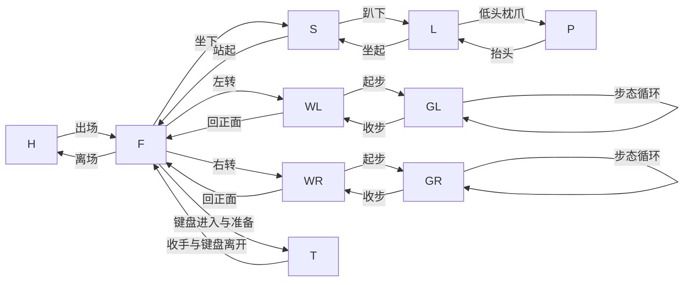

# 动作库与依赖顺序

这是一份可裁剪的默认动作设计，不要求每只宠物恰好生成 40 段。用户要“类似诞诞”而未缩小范围时，默认规划基础姿态、日常变化、左右拖动、三姿态摸头、打字以及出入场；全部写入生产计划，按阶段制作。物种不适合的动作需替换并说明。

## 状态与主干

F 正面站立；S 正面坐姿；L 抬头趴姿；P 枕爪趴姿；WL/WR 左右侧身站姿；GL/GR 左右行走的指定步态相位；T 有键盘的打字姿态；H 隐藏。F、S、L、P 不强制等高，侧身左右花纹不能默认镜像。站稳和正在迈步是不同连接状态。

F/S/L/P 各有同姿态循环和所选小动作。任何非 F 姿态要有通向 F 和离场的路线；持续互动还要有取消与自然收尾路线。

## A. 第一阶段：基础闭环

| ID | 动作 | 起点→终点 | 首图来源 | 终点／尾帧用途 |
| --- | --- | --- | --- | --- |
| A01 | 站姿呼吸、自然摇尾待机 | F→F | I-F | 回 F；其他站姿动作继续复用 I-F |
| A02 | 自然坐下 | F→S | I-F | 合格 E-S 建立坐姿基准 |
| A03 | 坐姿呼吸待机 | S→S | E-S | 回 S；尽量正向自然闭环 |
| A04 | 从坐姿站起 | S→F | E-S | 对照 I-F，自然承重站稳 |

先完成这四段及 I-F，再做后续；这里的“第一阶段”不意味着其余已选动作可以省略提示词。

## B. 第二阶段：趴姿与自然变化

| ID | 动作 | 起点→终点 | 首图来源 | 尾帧与备注 |
| --- | --- | --- | --- | --- |
| A05 | 坐姿到抬头趴姿 | S→L | E-S | 合格 E-L 建立趴姿基准 |
| A06 | 抬头趴姿待机 | L→L | E-L | 呼吸／耳朵微动，回 L |
| A07 | 低头枕在前爪 | L→P | E-L | 合格 E-P 建立枕爪基准 |
| A08 | 枕爪待机 | P→P | E-P | 保留轻微呼吸，回 P |
| A09 | 枕爪抬头 | P→L | E-P | 回到已有 E-L，优先自然正向 |
| A10 | 趴姿坐起 | L→S | E-L | 回到 E-S，优先自然正向 |
| A11 | 站姿舔鼻 | F→F | I-F | 一次动作后自然归位 |
| A12 | 站姿歪头／好奇 | F→F | I-F | 分清画面左／右，归位 |
| A13 | 自然叫声动作 | F→F | I-F | 狗吠／猫叫等按物种选择；声音可另做 |
| A14 | 看向画面左侧并回正 | F→F | I-F | 小幅头颈运动；不变成转身 |
| A15 | 看向画面右侧并回正 | F→F | I-F | 同上 |
| A16 | 坐姿观察／歪头 | S→S | E-S | 同坐姿尺度，回 E-S |

挠耳、伸懒腰、睡眠等可扩展；若选中也要增加对应进入、返回和参考，而不是只写一个名字。

## C. 第三阶段：左右拖动走路

| ID | 动作 | 起点→终点 | 首图来源 | 尾帧与依赖 |
| --- | --- | --- | --- | --- |
| W01 | 正面转向画面左侧 | F→WL | I-F | E-WL；看得到脚步，不能整体旋转 |
| W02 | 左侧起步与原地行走循环 | WL→GL，循环 GL→GL | E-WL；循环首图由进入步态的合格帧建立 | 同源拆进入／循环；首尾步态相位匹配，窗口平移由程序负责 |
| W03 | 左侧收步、转回正面 | GL→WL→F | W02 可收步相位帧 | 回 I-F；必要时分收步和回转两段 |
| W04 | 正面转向画面右侧 | F→WR | I-F | E-WR；右侧特征需要参考依据 |
| W05 | 右侧起步与原地行走循环 | WR→GR，循环 GR→GR | E-WR；循环首图由进入步态的合格帧建立 | 不默认用左走镜像 |
| W06 | 右侧收步、转回正面 | GR→WR→F | W05 可收步相位帧 | 回 I-F；必要时拆段 |

替代制作路线：每侧生成一段完整“正面→转身→走几步→收步→回正面”，然后实看切成 enter/loop/exit。若漏转身就使用上表分段方案。已在走动循环时收到新指令，不能将任意抬脚帧直接当站立图；在合法相位收步、反向或进入桥接。

## D. 第四阶段：三姿态摸头

| ID | 动作 | 起点→终点 | 首图来源 | 内容要求 |
| --- | --- | --- | --- | --- |
| M01 | 站姿摸头 | F→F | I-F | 手进入、轻抚、宠物反应、手离开、回站姿 |
| M02 | 坐姿摸头 | S→S | E-S | 保持坐姿，不临时站起来 |
| M03 | 枕爪摸头 | P→P | E-P | 若先抬头响应则显式增加 P↔L 路线 |

手是允许内容；注明从画面哪边进入、是否保留、结束是否完全离开，不能在全局负面词里禁止所有人手。

## E. 第五阶段：键盘互动

默认先做一个完整连续视频 K00：`F → 键盘出现 → 坐好并抬爪 → 敲击循环 → 收爪站起 → 键盘消失 → F`，再根据实际成片分出 K-enter、K-loop、K-exit。这样保持同一场景和坐标；不要先写死切点帧号。

若平台长动作不稳定，改为以下独立动作，并逐段交接：

| ID | 动作 | 起点→终点 | 参考与依赖 |
| --- | --- | --- | --- |
| K01 | 注意到输入、键盘进入 | F→F-with-keyboard | I-F；尾帧含键盘，不能仍标成无道具 F |
| K02 | 进入打字姿态 | F-with-keyboard→T | K01 合格尾帧；E-T 为专用姿态 |
| K03 | 正向敲击循环 | T→T | E-T；爪、键盘位置及首尾相位稳定 |
| K04 | 收爪、站起、键盘退出 | T→F | K03 可收尾相位帧；终点 I-F |

循环变体、短暂停顿看主人可以后补。程序还要处理准备途中停止输入、循环中停止和恢复，不能为了收尾强制再播一轮敲击。不同道具状态用独立节点，避免隐藏的接点错误。

## F. 出入场

E01 为 H→F 的出现与走近；E02 为 F→H 的离开。若含传送门、远近变化或特效，拆出独立状态，不把远处小体型直接接近处 F。最终全透明帧是消失结果，不可拿来生成下一条宠物动作。

## 计划顺序与通过条件

顺序：角色与 I-F → 第一阶段站坐往返 → 趴姿往返 → 各姿态小动作 → 单侧走路闭环 → 另一侧 → 摸头 → 键盘 → 出入场 → 全路线接缝 → 透明导出与程序。

一个计划合格，需要用户无需追问就能知道：每条视频前应完成什么、每张静态图是否真的要生成、拿哪一帧继续、失败回退到哪里、从每个姿态怎样返回、哪些是同源拆段，以及下一步实际操作。默认顺序可按素材已有程度调整，但不能破坏依赖。
